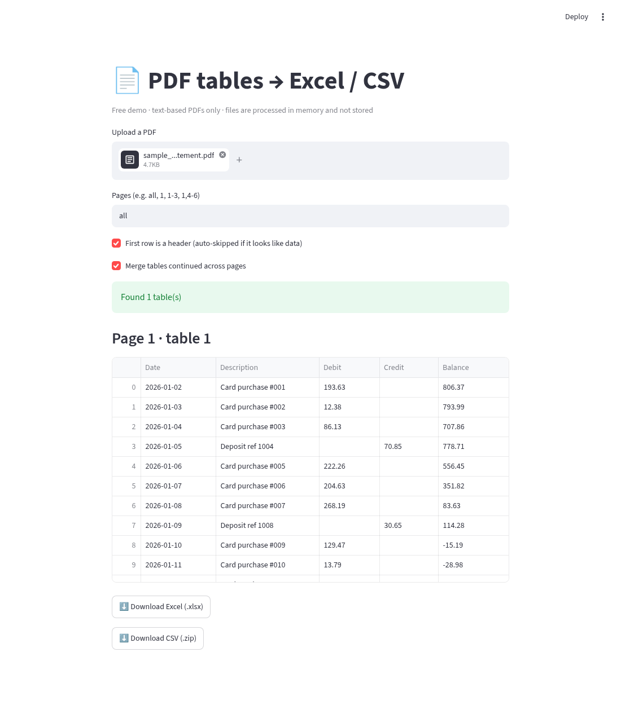

# pdf2excel — PDF tables → Excel / CSV

Extract tables from text-based PDFs (invoices, bank statements, reports) into a clean Excel workbook (one sheet per table) or CSV files. Includes a command-line tool and a simple Streamlit web UI.



## Features
- Detects ruled (gridline) tables and borderless, whitespace-aligned tables (pdfplumber)
- XLSX export: one sheet per table (`p<page>_t<n>`), bold header, frozen header row, auto column widths, numeric columns (incl. `1,234.56`) converted to numbers
- CSV export: one file per table
- Header detection: if the first row looks like data (numbers), generic `Column 1..N` headers are used
- `--merge`: join tables continued across consecutive pages (same headers) into one sheet, dropping repeated header rows
- Page selection: `1`, `1-3`, `1,4-6`, `3-`
- Optional camelot fallback (`pip install -e ".[camelot]"`, then `--camelot`)

## Install
```bash
python3 -m venv .venv && source .venv/bin/activate
pip install -e ".[web,dev]"      # core only: pip install -e .
```

## CLI usage
```bash
pdf2excel samples/sample_invoice.pdf -o invoice.xlsx       # one sheet per table
pdf2excel samples/sample_bank_statement.pdf --csv -o stmt.csv   # stmt_p1_t1.csv, stmt_p2_t1.csv
pdf2excel samples/sample_bank_statement.pdf --merge -o stmt.xlsx   # one sheet, 40 rows
pdf2excel samples/sample_bank_statement.pdf -p 2 -o page2.xlsx
pdf2excel report.pdf --no-header                           # keep first row as data
```

## Web UI
```bash
streamlit run src/pdf2excel/web.py
```
Upload a PDF, preview the tables, and download XLSX or a ZIP of CSVs. Files are processed in memory.

## Sample PDFs
`samples/` holds **synthetic** PDFs generated by `scripts/gen_samples.py` (reportlab). All names, accounts, and numbers are fictional.

## Tests
```bash
pytest --cov=pdf2excel
```

## Limits (free version)
- **Text-based PDFs only.** Scanned/image PDFs have no text layer; they need OCR, which is in the **Pro version**.
- One PDF at a time (batch processing is a Pro feature).
- Complex layouts (merged cells, multi-line headers, tables with no alignment) may need manual cleanup or a custom template.
- Encrypted/password-protected PDFs aren't supported.

## Need custom extraction?
Hire me on Upwork for custom templates, batch processing, or scanned PDFs: [UPWORK_PROFILE_LINK]

## License
MIT — see [LICENSE](LICENSE).
